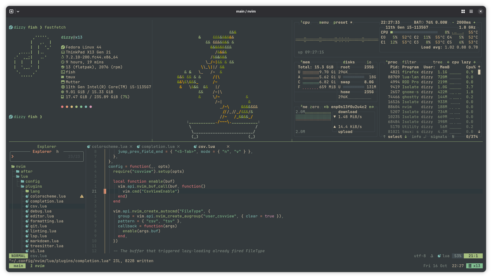

# Dotfiles


My terminal setup on Fedora: Ghostty + fish + tmux + Neovim, themed with **Everforest Dark Hard**
and a transparent background throughout.



## Contents

- [Overview](#overview)
- [Ghostty](#ghostty)
- [fish](#fish)
- [Starship](#starship)
- [Neovim](#neovim)
- [tmux](#tmux)
- [fastfetch](#fastfetch)
- [btop](#btop)
- [bat](#bat)
- [fzf](#fzf)
- [zathura](#zathura)

## Overview

| Config | Path in this repo | Goes to |
|---|---|---|
| Ghostty | [`ghostty/config`](ghostty/config) | `~/.config/ghostty/config` |
| fish | [`fish/`](fish/) | `~/.config/fish/` |
| Starship | [`starship.toml`](starship.toml) | `~/.config/starship.toml` |
| Neovim | [`nvim/`](nvim/) | `~/.config/nvim/` |
| tmux | [`.tmux.conf`](.tmux.conf) | `~/.tmux.conf` |
| fastfetch | [`fastfetch/config.jsonc`](fastfetch/config.jsonc) | `~/.config/fastfetch/config.jsonc` |
| btop | [`btop/`](btop/) | `~/.config/btop/` |
| bat | [`bat/`](bat/) | `~/.config/bat/` |
| fzf | [`fish/conf.d/fzf.fish`](fish/conf.d/fzf.fish) | `~/.config/fish/conf.d/fzf.fish` |
| zathura | [`zathura/zathurarc`](zathura/zathurarc) | `~/.config/zathura/zathurarc` |

Every config uses the same [Everforest Dark Hard palette](https://github.com/sainnhe/everforest/blob/master/palette.md):

| Role | Color |
|---|---|
| Text | `#d3c6aa` |
| Background (only where one is painted) | `#272e33` |
| Borders, muted UI | `#414b50` · `#859289` |
| Accents | red `#e67e80` · orange `#e69875` · yellow `#dbbc7f` · green `#a7c080` · aqua `#83c092` · blue `#7fbbb3` · purple `#d699b6` |

Requirements shared by everything: a [Nerd Font](https://www.nerdfonts.com/) in the terminal
(JetBrainsMono Nerd Font here) and a terminal with true color.

Install everything on Fedora:

```sh
sudo dnf install fish tmux neovim fastfetch btop bat fzf fd-find eza ripgrep zathura zathura-pdf-poppler

# Ghostty (COPR)
sudo dnf copr enable scottames/ghostty
sudo dnf install ghostty

# Starship (official install script)
curl -sS https://starship.rs/install.sh | sh
```

Then copy (or symlink) each config to the path in the table above.

## Ghostty

Config: [`ghostty/config`](ghostty/config).

- Everforest Dark Hard theme, JetBrainsMono Nerd Font
- 90% background opacity with blur. Neovim, tmux, Starship, fzf and btop paint no background, so
  this transparency shows through everywhere
- No popup notification on clipboard copy

## fish

Config: [`fish/config.fish`](fish/config.fish), plus [`fish/conf.d/`](fish/conf.d/) and
[`fish/themes/`](fish/themes/). Needs fish 4.0+.

- **Everforest syntax colors** ([`fish/themes/everforest-dark-hard.theme`](fish/themes/everforest-dark-hard.theme)),
  applied from `config.fish` with `fish_config theme choose`:

  | Element | Color |
  |---|---|
  | Command | green |
  | Keyword (`if`, `for`, `function`) | purple |
  | Argument | blue |
  | Option (`--force`) | aqua |
  | String | yellow |
  | Pipe, `;`, `&`, redirect | orange |
  | Comment | grey italic |
  | Error | red |
  | Autosuggestion | dim grey |

- `EDITOR`/`VISUAL` set to `nvim`
- Aliases:

  | Alias | Runs |
  |---|---|
  | `vim` | `nvim` |
  | `cat` | `bat --paging=never` |
  | `ls` | `eza --icons --color` |
  | `ll` | `eza -l -g --icons --color` |
  | `la` | `eza -A -l -g --icons --color` |

- Starship prompt and fzf key bindings (see below)

Run `fish_config theme demo` to preview every syntax color.

## Starship

Config: [`starship.toml`](starship.toml). A minimal one-line prompt:

```
 dizzy nvim  main  v5.4.8 󱎫 3s ❯
```

| Part | Color | Shown |
|---|---|---|
| OS logo | blue | Always (Fedora, Arch, Ubuntu, Debian, macOS or generic Linux) |
| Username | aqua (red as root) | Always |
| Folder | bold green | Always, current folder only |
| Git branch | italic purple | Inside a git repo |
| Language logo + version | per language | In a project of that language |
| Command time | grey | After commands that take over 2 seconds |
| `❯` | green / red | Red after a failed command; `❮` in vi mode |

Languages and tools: Node.js, Python, Rust, Go, Lua, C, C++, CMake, Java, C#/.NET, Docker
(Dockerfile, Containerfile or compose file; falls back to `podman` for the version) and Kubernetes
(current context and namespace, only in folders with Kubernetes or Helm files).

To add another language, add its module to `format` and give it a section with the same
`format = "[$symbol($version)]($style) "`. Write icons as `\uXXXX` escapes so editors can't strip
them.

## Neovim

A modular Lua config for **Neovim 0.12+** built on lazy.nvim, in [`nvim/`](nvim/).

- Everforest theme with a transparent background, dashboard, file tree, tab bar, smooth scrolling
- LSP, completion, formatting, linting and debugging for Lua, Python, JS/TS & web, Rust, Go,
  C/C++, Java and C#
- Fuzzy finder, git integration, markdown and CSV preview
- `<C-h/j/k/l>` moves between Neovim splits and tmux panes with the same keys

Install:

```sh
cp -r nvim ~/.config/nvim   # or: ln -s "$PWD/nvim" ~/.config/nvim
nvim                        # plugins and language tools install on first start
```

👉 **See [`nvim/README.md`](nvim/README.md)** for requirements, the full plugin list, keymaps and how-tos.

## tmux

Config file: `~/.tmux.conf`, for tmux 3.3+. Plugins are managed by [TPM](https://github.com/tmux-plugins/tpm).

### Features

- **Everforest Dark Hard** status bar, pane borders and messages, with no status-bar background so
  the terminal's transparency shows through
- Session name in a green block that turns **orange while the prefix is active**
- Current window in green bold italic, matching the Neovim tab bar
- True color, mouse support, 50,000 lines of scrollback, windows and panes numbered from 1
- No `<Esc>` delay and focus events turned on, for Neovim
- Splits and new windows open in the current folder
- Vi copy mode that copies to the system clipboard

### Plugins

| Plugin | Purpose |
|---|---|
| [tmux-plugins/tpm](https://github.com/tmux-plugins/tpm) | Plugin manager |
| [tmux-plugins/tmux-sensible](https://github.com/tmux-plugins/tmux-sensible) | Sensible defaults |
| [tmux-plugins/tmux-yank](https://github.com/tmux-plugins/tmux-yank) | `y` in copy mode copies to the system clipboard |
| [christoomey/vim-tmux-navigator](https://github.com/christoomey/vim-tmux-navigator) | `C-h/j/k/l` across tmux panes and Neovim splits (the Neovim side is in `nvim/`) |

### Install

Requirements: tmux 3.3+, `git`, a [Nerd Font](https://www.nerdfonts.com/) in the terminal, and a
clipboard tool: `wl-copy` (Wayland), `xclip`/`xsel` (X11) or `pbcopy` (macOS).

```sh
# 1. Install TPM
git clone https://github.com/tmux-plugins/tpm ~/.tmux/plugins/tpm

# 2. Put the config in place (back up any existing one first)
cp ~/.tmux.conf ~/.tmux.conf.bak 2>/dev/null
cp .tmux.conf ~/.tmux.conf

# 3. Start tmux and install the plugins
tmux
# then press: C-b I
```

If tmux was already running, restart the server (`tmux kill-server`) so true color and the theme
apply.

### Keys

The prefix is the default **`C-b`**. Press `C-b` twice to send a literal `C-b` to the program inside.

| Key | Action |
|---|---|
| `C-h/j/k/l` (no prefix) | Move between tmux panes **and** Neovim splits |
| `prefix \|` / `prefix -` | Split side by side / top and bottom (current folder) |
| `prefix c` | New window (current folder) |
| `prefix n` / `prefix p` / `prefix 1-9` | Next / previous / numbered window |
| `prefix <` / `prefix >` | Move window left / right |
| `prefix H/J/K/L` | Resize pane (hold to repeat) |
| `prefix z` | Zoom pane (󰊓 shows in the status bar) |
| `prefix x` | Close pane |
| `prefix d` | Detach (`tmux a` to reattach) |
| `prefix s` | Pick a session or window |
| `prefix C-l` | Clear the shell (plain `C-l` is pane navigation) |
| `prefix r` | Reload `~/.tmux.conf` |
| `prefix I` / `prefix U` | Install / update plugins (TPM) |

### Copy mode

| Key | Action |
|---|---|
| `prefix [` | Enter copy mode (`COPY` shows in the status bar) |
| `h/j/k/l`, `w/b`, `C-u/C-d`, `/` `?` | Move and search like Vim |
| `v` / `C-v` | Start a selection / toggle block selection |
| `y` | Copy to the system clipboard and leave copy mode |
| `Esc` or `q` | Leave copy mode |

Selecting text with the mouse also copies it.

### Customize

- **Colors:** the Everforest palette is a set of variables (`bg1`, `fg`, `green`, …) in the theme
  section of `~/.tmux.conf`. Change them there; the palette is listed in
  [Everforest's docs](https://github.com/sainnhe/everforest/blob/master/palette.md).
- **Status bar position:** `set -g status-position top`.
- **A different prefix**, e.g. `C-a`: replace `C-b` in the first two `set -g prefix` / `bind` lines.

## fastfetch

Config: [`fastfetch/config.jsonc`](fastfetch/config.jsonc). Needs fastfetch 2.x.

- Small Fedora logo in Everforest green
- `user@host` header, then one line each for OS, laptop model, kernel, uptime, packages, shell,
  terminal, window manager, CPU, memory and root-disk usage
- Each line is labelled with a green Nerd Font icon instead of a word
- A row of Everforest accent dots at the bottom instead of the terminal's 16 colors

To show more disks, change the disk module's `"folders": "/"` to e.g. `"/:/home"`.

## btop

Config: [`btop/btop.conf`](btop/btop.conf) and the theme
[`btop/themes/everforest-dark-hard.theme`](btop/themes/everforest-dark-hard.theme).

- Custom Everforest Dark Hard theme. btop ships one, but it uses off-palette reds and draws
  inactive text in the background color
- `theme_background = false`, so the terminal's transparency shows through
- Box borders in the same grey as tmux pane borders, green hotkey letters
- CPU, memory and temperature graphs go green → yellow → red; download is blue/aqua, upload
  orange/red

## bat

Config: [`bat/config`](bat/config) and the theme
[`bat/themes/everforest-dark-hard.tmTheme`](bat/themes/everforest-dark-hard.tmTheme).

- Everforest Dark Hard syntax theme (bat doesn't ship one), using the same syntax colors as
  Everforest in Neovim: keywords red, functions green, strings aqua, types yellow, numbers purple,
  comments grey italic
- Line numbers, git change markers and the file name header
- `.conf` files and `.tmux.conf` are highlighted

After installing or editing the theme, rebuild bat's cache:

```sh
bat cache --build
```

## fzf

Config: [`fish/conf.d/fzf.fish`](fish/conf.d/fzf.fish). Needs fzf 0.48+, `fd`, `bat` and `eza`.

- Everforest colors with no background; rounded border in the tmux border grey
- Lists files with `fd` (hidden files included, `.git` skipped)
- Preview on the right: files through **bat**, folders as an **eza** tree. Anything else (for
  example `printf 'a\nb' | fzf`) gets an empty preview

| Key | Action |
|---|---|
| `fzf` | Pick a file, with preview |
| `Ctrl-T` | Insert a file or folder path at the cursor |
| `Alt-C` | `cd` into a folder (tree preview) |
| `Ctrl-R` | Search command history (`?` shows long commands in full) |
| `Ctrl-/` | Inside fzf: show or hide the preview |
| `fzfp` | Pick a file with preview and open it in `$EDITOR` |

## zathura

Config: [`zathura/zathurarc`](zathura/zathurarc).

- Everforest Dark Hard status bar, command line, messages, index (`Tab`) and completion menu;
  dark background around pages
- PDF pages keep their **original colors**. `Ctrl-R` temporarily recolors a document in Everforest
- JetBrainsMono Nerd Font for the interface
- Selected text goes to the system clipboard; search updates as you type
- Opens at page width in a 2560×1440 window

## License

[MIT](LICENSE)
